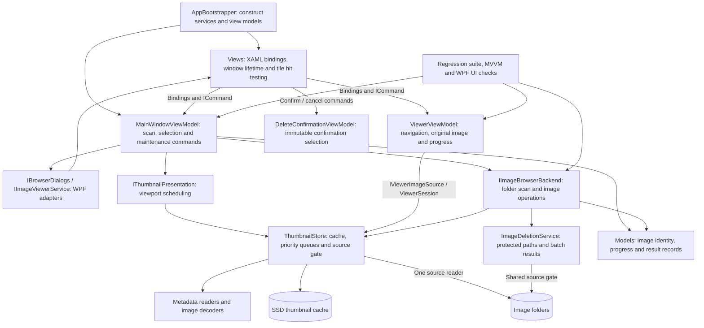

# Codebase structure



## Files and responsibilities

```text
src/CardViewer/
  Program.cs                           Application and CLI entry points
  AppBootstrapper.cs                   Composition: constructs and connects services
  Backend/
    Imaging/                           Metadata readers and image decoders
    Storage/
      IImageBrowserBackend.cs           Scanning and maintenance contract
      ImageBrowserService.cs            Background scan and backend operations
      ThumbnailStore.cs                Progressive loading and persistent cache
      ImageDeletionService.cs           Protected source deletion
      ImageFileFilter.cs                Supported extensions and dot-file policy
      IViewerImageSource.cs             Full-image loading contract
    Scheduling/PriorityWorkQueue.cs     Worker priorities and FIFO ordering
    Diagnostics/                       Pipeline logs and thumbnail benchmarks
  Frontend/
    Commands/
      RelayCommand.cs                  Synchronous ICommand with enablement
      AsyncCommand.cs                  Awaitable command; prevents re-entry
    ViewModels/
      ObservableObject.cs              Property-change notifications
      MainWindowViewModel.cs           Folder, selection, deletion and maintenance
      ViewerViewModel.cs               Navigation, original image and progress
      ViewerSession.cs                 Loads the preview and full original asynchronously
      DeleteConfirmationViewModel.cs   Confirmation snapshot and command guards
      ImageItem.cs / ImageRow.cs        Bindable tile state and virtualized rows
    Services/
      IBrowserDialogs.cs               Folder, confirmation and error dialog contract
      WpfBrowserDialogs.cs             Native picker and themed modal windows
      IImageViewerService.cs            Viewer window lifetime contract
      WpfImageViewerService.cs          Opens/closes viewers and drains old requests
      IThumbnailPresentation.cs         Viewport work contract
      ThumbnailViewport.cs              Reconciles recycled tile visibility after layout
      ThumbnailScheduler.cs            Dispatcher publication and visible-item priority
    Views/
      MainWindow.xaml[.cs]              Grid bindings and tile lifetime/hit testing
      ViewerWindow.xaml[.cs]            Image/progress bindings and keyboard commands
      DeleteConfirmationWindow.cs      Confirmation controls and dialog result
      ErrorDetailsWindow.cs            Scrollable error presentation
    Themes/                            Shared colors and WPF control templates
  Models/                              Image identities, metadata, progress and results
tests/CardViewer/                      Regression, UI operations and build verification
TestImages/                            Read-only reference/sample data
artifacts/                             Generated fixtures, caches and reports
docs/                                  Architecture documentation
```

These are folders within the existing WPF application, not separate executables. The `CardViewer` namespace and CLI entry points remain stable. Tests live outside `src` and are explicitly included by the project, preserving automatic verification without another test framework.

## MVVM responsibilities

The main and viewer windows bind their controls to view-model properties and `ICommand` implementations. View models own application state, command enablement, selection, scan cancellation, deletion orchestration and maintenance. They do not construct windows, display dialogs, access controls, or use a WPF dispatcher directly. `AppBootstrapper` supplies backend and UI services.

`MainWindow` code-behind only forwards virtualized tile visibility and hit-tested image clicks to commands and handles window lifetime. `ViewerWindow` code-behind handles loading, closing, and the view model's close request. These are view responsibilities. Confirmation uses an immutable view-model snapshot and confirm/cancel commands; setting `DialogResult` stays in the view.

`ImageBrowserService` enumerates folders off the UI thread in batches under the shared source gate. The main view model consumes those batches on its UI synchronization context. Replacing a folder cancels its previous scan, and cancellation is checked before publishing each batch. Asynchronous maintenance commands prevent re-entry, pause thumbnail work, drain viewer operations, and restore command enablement in `finally` blocks.

`TestImages` contains sample fixtures, not machine-learning training data. There is no training pipeline. Under a one-time permission, twelve packaged format fixtures were added without changing any pre-existing files. Subsequent tests read TestImages only; generated unit files and disposable copies belong in `artifacts`.

## Loading flow

The grid uses `ThumbnailViewport` to reconcile realized tile bounds after scrolling and layout, then forwards visibility to main view-model commands. This releases old thumbnail work even when WPF keeps recycled visuals alive without an unload event. The commands ask the scheduler for visible tiles. The scheduler first checks the SSD cache, then publishes an embedded HIF or JPEG preview, and finally replaces it with the cached 320px thumbnail. JPEG EXIF probing reads less than 32 KB; missing or over-budget previews skip to refinement. JPEG refinement uses scaled decoding of the main image. HEIC/HEIF also attempts embedded-JPEG probing. PNG/TIFF/BMP/WebP/AVIF go straight to grid decoding, with PNG cache output for alpha-capable formats. Leaving the viewport cancels that tile's request.

The viewer view model uses `ViewerSession` to request a separate 1600px preview, then loads only the selected full original. Navigation cancels the old selection. RAW companions are not requested by the viewer; backend association remains used for export.

`ThumbnailStore` owns separate queues for source reads, ordinary decoding, RAW decoding, and cache writes. Lower numeric priorities run first; equal priorities preserve insertion order. `SourceGate` serializes source access, including folder metadata scanning. Decode and SSD writes can continue independently after source bytes have been read.

Every build runs `BuildVerification`, which executes regression checks and a cold/warm thumbnail benchmark with an isolated cache. Source hashes confirm that fixtures remain unchanged. RAW coverage focuses on cancellation and viewer behavior rather than repeated full decodes.

Deletion starts with tile checkboxes or Select all. A modal dialog confirms an immutable snapshot of exact file paths. The main view model pauses thumbnail work and closes the viewer through UI services before calling the backend deletion operation. That service uses the same source gate as reading, refuses `TestImages` and linked paths, rechecks file identity metadata, and returns individual successes and failures. Before confirmation, the backend adds same-folder, same-stem RAW companions to the exact file snapshot, deduplicating shared companions. Deletion accepts RAW only alongside a matching selected original and applies the same protection and metadata checks to both. The grid removes successful results and retains failed selections.


Deletion confirmation projects its unchanged exact file snapshot into `DeletionGroup` rows keyed by full directory and base name. Rows display one name, a stacked-file icon, format badges, the shared extensionless full path, and individual paths in a tooltip; command guards and backend deletion still operate on every underlying file.

`ViewerWindow` owns image-fit presentation: it calculates proportional image size plus header/window padding, caps it to the current monitor work area in device-independent units, and preserves minimum window dimensions. Metadata probing provides the original oriented dimensions before the viewer is revealed; only those dimensions trigger fitting. Thumbnail and full-image updates do not resize the window. There is no manual Fit button. The view model supplies image name, format and position for the styled header.

ExportSelectedCommand requests a destination through IBrowserDialogs and delegates to ImageExportService through the backend. The service discovers and deduplicates matching RAW companions, then streams source bytes into lossless ZIP entries on a background task. SourceGate protects individual read chunks and is released during compression and output writes. A temporary archive is atomically published after finalization under a unique name; interrupted archives are removed. ExportResult returns ArchivePath plus per-file successes/failures. ExportProgress reports throttled byte and file counts. Export does not pause thumbnail scheduling or close the viewer; the grid stays scrollable and OpenImageCommand remains available while conflicting source operations are disabled.

FileTypeTag centralizes the extension palette used by tile badges, the viewer header, and grouped deletion tags. Each supported image/RAW extension has a distinct background and foreground pair. Text labels retain the format meaning independently of color.

FormatTests copies packaged TestImages/format-sample fixtures into artifacts before destructive checks; no format encoder or external sample downloader runs during integration tests. Unit tests still generate small malformed metadata and synthetic source files where necessary. `docs/test-images.md` documents sample provenance; build verification writes current source hashes under `artifacts/build-verification`.

ThumbnailDiskCache budgets hash-named 320px JPG/PNG files to 2,000,000,000 bytes. Background startup indexes managed files and prunes least-recently-used entries; cache hits explicitly touch their cache-file LastWriteTimeUtc as a persistent application-managed access stamp. Publishing, reading and eviction share an async SSD gate. Writes update the byte total and prune oldest eligible stamps. Locked entries are skipped. Old preview1600 entries are removed; GetPreviewAsync generates a memory-only 1600px bitmap without cache lookup or publication.

MainWindow forwards modifier gestures to SelectRangeCommand with an immutable RangeSelectionRequest. The view model owns the anchor and batches selection updates across the inclusive range, including unrealized tiles. Ctrl+Shift adds ranges; Ctrl-click toggles individual tiles. The theme styles both scrollbar orientations and keeps PART_Track, paging commands and thumb drag behavior.

